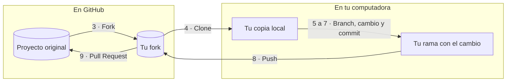

# Cheatsheet: tu primer PR (track Primeros Pasos)

[Inicio](../../README.md) · [Recursos de código](README.md)

 

Guía de referencia rápida para el track **Primeros Pasos**. No asume ningún conocimiento previo. Para el guion completo de mentoría de este track, ver [`../../docs/05-programa/contenido-charlas.md`](../../docs/05-programa/contenido-charlas.md#primeros-pasos).

Para una práctica completa con el archivo de Python, las dos rutas (navegador y terminal), el texto del PR y la revisión, ver el [ensayo para mentores](demo-primer-pr/README.md). El cambio de `saludo()` es una práctica; después se elige una contribución útil siguiendo las reglas del proyecto.

## Glosario mínimo

| Término | Qué es |
| --- | --- |
| Repositorio (repo) | La carpeta de un proyecto, con todo su historial de cambios |
| Fork | Tu propia copia de un repositorio ajeno, en tu cuenta de GitHub |
| Clone | Descargar un repositorio (o tu fork) a tu computadora |
| Branch (rama) | Una línea de trabajo separada para tu cambio, sin afectar el resto |
| Commit | Un "guardado" de tus cambios, con un mensaje explicando qué hiciste |
| Pull Request (PR) | Tu propuesta de cambio, para que el proyecto original la revise y la incorpore |

## Pasos para tu primera contribución

Tu cambio viaja por tres lugares: el proyecto original, tu copia en GitHub (fork) y tu computadora. El número de cada flecha es el paso de la lista de abajo.



1. **Crea una cuenta en GitHub** (si no tienes): [github.com/join](https://github.com/join)
2. **Elige un proyecto** de [`../../docs/05-programa/proyectos-sugeridos.md`](../../docs/05-programa/proyectos-sugeridos.md) (tabla "Track Primeros Pasos"), o practica primero con el mini-repo de la demo: [`demo-primer-pr/`](demo-primer-pr/)
3. **Haz fork** del repositorio (botón "Fork" arriba a la derecha en GitHub)
4. **Clona tu fork:**

   ```bash
   git clone https://github.com/TU-USUARIO/nombre-del-repo.git
   cd nombre-del-repo
   ```

5. **Crea una rama para tu cambio:**

   ```bash
   git checkout -b mi-primera-contribucion
   ```

6. **Haz tu cambio** — código, documentación, traducción, o corrige algo que esté roto.
7. **Guarda tu cambio (commit):**

   ```bash
   git add .
   git commit -m "Describe brevemente qué cambiaste"
   ```

8. **Sube tu rama a tu fork:**

   ```bash
   git push origin mi-primera-contribucion
   ```

9. **Abre el Pull Request** desde GitHub: verás un botón "Compare & pull request" al entrar a tu fork.

## No solo código

Todo esto también es una contribución real:

- Corregir un error de ortografía o un enlace roto en la documentación
- Traducir un `README` u otro archivo a español
- Reportar un error (abrir un "Issue" describiendo el problema)

## Si algo no funciona

Avisa a un mentor — no hay pregunta "demasiado básica" en este track.
